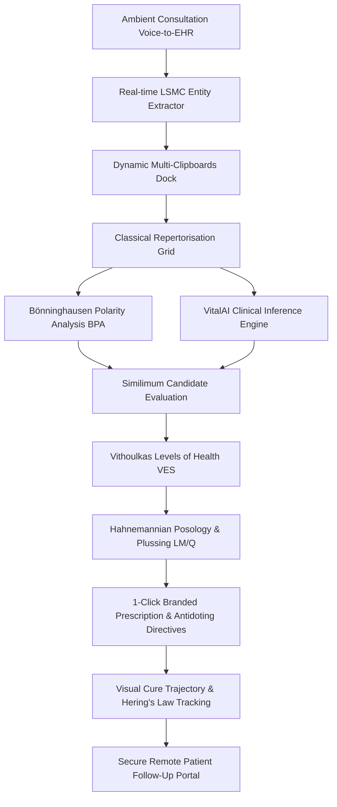

# 📘 VitalFokus Clinical Intelligence Platform — Master Cookbook & Usage Guide
> **Version 2.4** • *Enterprise-Grade Kentian Repertorisation, VitalAI Inference, Posology & Sovereign Practice Management*

---

## 🌟 Executive Overview & Clinical Architecture

VitalFokus is an advanced, radaropus-grade clinical intelligence and homeopathic repertorisation suite. Designed for modern classical practitioners, it bridges **Kentian totality**, **Bönninghausen polarity analysis**, **Jan Scholten’s periodic taxonomy**, and **George Vithoulkas’s Levels of Health** with real-time **ambient voice-to-EHR extraction** and **AES-256-GCM encrypted sovereign data security**.



---

## 📑 Table of Contents

1. [Quickstart & Global Navigation](#1-quickstart--global-navigation)
2. [Dynamic Multi-Clipboard Repertorisation](#2-dynamic-multi-clipboard-repertorisation)
3. [Bönninghausen Polarity Analysis (BPA) & Frei Algorithm](#3-bönninghausen-polarity-analysis-bpa--frei-algorithm)
4. [Vithoulkas Expert System (VES) & 12 Levels of Health](#4-vithoulkas-expert-system-ves--12-levels-of-health)
5. [Kingdom & Taxonomy Explorer (Scholten, Sankaran, Yakir)](#5-kingdom--taxonomy-explorer-scholten-sankaran-yakir)
6. [Voice-to-EHR Ambient Case-Taking & Real-Time LSMC Extraction](#6-voice-to-ehr-ambient-case-taking--real-time-lsmc-extraction)
7. [Remedy Relationship & Family Graph Visualizer](#7-remedy-relationship--family-graph-visualizer)
8. [Hahnemannian Posology & Split-Dose Plussing Engine](#8-hahnemannian-posology--split-dose-plussing-engine)
9. [1-Click Branded Prescription Generator & Organon § 260](#9-1-click-branded-prescription-generator--organon--260)
10. [Visual Cure Trajectory & Hering's Law Verification](#10-visual-cure-trajectory--herings-law-verification)
11. [Secure Remote Follow-Up Patient Portal](#11-secure-remote-follow-up-patient-portal)
12. [Extended Classical Materia Medica Library](#12-extended-classical-materia-medica-library)
13. [Multi-Language Repertory Engine](#13-multi-language-repertory-engine)
14. [Automated Cloud Backup & HIPAA/GDPR Sovereign Encryption](#14-automated-cloud-backup--hipaagdpr-sovereign-encryption)
15. [Master Clinical Cheat-Sheet & Keyboard Shortcuts](#15-master-clinical-cheat-sheet--keyboard-shortcuts)

---

## 1. Quickstart & Global Navigation

### Left Navigation Rail
* **Clinical Dashboard (`Ctrl+1`)**: Practice KPI cards, active patient stats, UHD brand banner, and quick-action triggers.
* **Patient EHR & Cases (`Ctrl+2`)**: Full electronic health records with demographics, constitutional profiles, and visit logs.
* **Repertory Explorer (`Ctrl+3`)**: Hierarchical search through Kentian chapters (Mind, Vertigo, Head, Eye, Vision, Stomach, etc.).
* **Repertorisation Grid (`Ctrl+4`)**: Dynamic numerical scoring matrix with weighted sum, totality, and eliminative algorithms.
* **Polarity Analysis (`Ctrl+5`)**: Heiner Frei polarity differential engine and contra-indication elimination.
* **Kingdom & Taxonomy (`Ctrl+6`)**: Interactive Scholten Periodic Table, APG IV Plant families, Animal classes, and Nosodes.
* **Materia Medica (`Ctrl+7`)**: 188+ classical remedy monographs with Kentian affinities and keynotes.
* **Comparative MM (`Ctrl+8`)**: Side-by-side differential analysis comparing 2 to 4 remedies simultaneously.
* **VitalAI Clinical Agent (`Ctrl+9`)**: Grounded clinical inference copilot with step-by-step case walkthroughs.

### Top Navbar Controls
* **Spotlight Search (`⌘K` or `Ctrl+K`)**: Global unified search for rubrics, remedies, or patient cases.
* **Active Case Pill**: Shows the currently selected patient. Clicking `×` unloads the case.
* **Clipboards Pill**: Toggles the multi-clipboard symptom grading dock.
* **Language Selector**: Real-time translation between 🇬🇧 English, 🇩🇪 German, 🇫🇷 French, 🇪🇸 Spanish, and 🇮🇳 Hindi.
* **Backup & HIPAA Modal**: One-click AES-256 cloud snapshot and encrypted restore.
* **Theme Toggle (Sun/Moon)**: Instant, zero-flicker toggle between Dark (`slate-950`) and Light (`slate-50`) modes.
* **Practitioner Profile**: Customise physician name, clinic credentials, and license details.

---

## 2. Dynamic Multi-Clipboard Repertorisation

### The Multi-Clipboard Concept
In classical practice, mixing physical generals, mental symptoms, and local particulars into a single list can skew remedy weights. VitalFokus supports up to **5 simultaneous active clipboards**:
1. **Mental Generals (Blue)**: Emotional disposition, fears, delusions, fastidiousness.
2. **Physical Generals (Emerald)**: Thermals (chilly vs. warm), appetite, thirst, sleep postures.
3. **Particulars & Organs (Purple)**: Local pathology, organ affinities (epigastrium, joints, skin).
4. **Modalities (Amber)**: Aggravations (`<`) and Ameliorations (`>`).
5. **Eliminative Keynotes (Rose)**: Essential qualifying symptoms.

### Grading Scale & Weighting
* **Grade 4 (Blue/Red Bold)**: Keynote symptom verified in multiple provings and repeated clinical cures.
* **Grade 3 (Bold)**: Well-confirmed characteristic symptom.
* **Grade 2 (Italic)**: Moderately marked symptom.
* **Grade 1 (Plain)**: Occasional symptom reported in provers.

---

## 3. Bönninghausen Polarity Analysis (BPA) & Frei Algorithm

Dr. Heiner Frei demonstrated that selecting remedies solely on high rubric grades frequently fails if a remedy has the **opposite modality** in its pathogenesis.

### Frei Algorithm Formula:
$$\text{Polarity Difference (PD)} = \sum \text{Patient Modalities} - \sum \text{Contra-Indications}$$

```text
[Patient Symptom]: Burning stomach < Cold drinks (Grade 3)
[Opposite Pole]  : Burning stomach > Cold drinks (Contra-Indication)

If Remedy A covers:
  - < Cold drinks: Grade 3
  - > Cold drinks: Grade 0 (No contra-indication)
  => Polarity Difference = +3 (SAFE TO PRESCRIBE)

If Remedy B covers:
  - < Cold drinks: Grade 1
  - > Cold drinks: Grade 4 (Strong contra-indication)
  => Polarity Difference = -3 (RULED OUT / CONTRA-INDICATED)
```

VitalFokus automatically computes Contra-Indications and displays severe warnings in red pills directly in the Polarity Panel.

---

## 4. Vithoulkas Expert System (VES) & 12 Levels of Health

Classifies the patient’s constitutional vitality into one of **4 Groups** and **12 Levels**:

| Group | Levels | High Fever Capability | Reaction to Correct Similimum | Prognosis |
|---|:---:|:---:|---|---|
| **Group A** | 1 – 3 | Capable of high fevers ($> 39.5^\circ\text{C}$) | Quick short aggravation then rapid cure (Kent Obs. 3) | Excellent; optimum defense |
| **Group B** | 4 – 6 | Rare high fevers ($< 38.5^\circ\text{C}$) | Prolonged aggravation followed by sustained recovery (Kent Obs. 1) | Very good; reversible pathology |
| **Group C** | 7 – 9 | Inability to produce acute fever | Long, severe aggravation. Danger of organ stress. (Kent Obs. 2) | Guarded; deep chronic miasms |
| **Group D** | 10 – 12 | Complete absence of fever | Amelioration without recovery or incurable pathology (Kent Obs. 10–12) | Palliative; low vital energy |

---

## 5. Kingdom & Taxonomy Explorer (Scholten, Sankaran, Yakir)

Navigate remedies according to their natural-order kingdoms and sub-families:

### 1. Mineral Kingdom (Scholten Periodic Table)
* **Series 1 (Hydrogen)**: Space, existence, incarnating.
* **Series 2 (Carbon)**: Self-worth, individual identity, body image.
* **Series 3 (Silica)**: Relationships, family, home, protection.
* **Series 4 (Ferrum)**: Duty, work, employment, daily routine, rules.
* **Series 5 (Silver)**: Creativity, performance, artistic expression, public speech.
* **Series 6 (Gold)**: Leadership, supreme responsibility, power, failure fears.
* **Series 7 (Uranium)**: Deep subconscious, transformation, breakdown.
* **18 Stages**: Progression from beginning (Stage 1), peak mastery (Stage 10), decay (Stage 15), to complete loss (Stage 18).

### 2. Plant Kingdom (APG IV Classification)
* Explores botanical families (*Solanaceae, Compositae, Ranunculaceae, Umbelliferae, Papaveraceae*).
* Core plant themes: Sensations, reactivity, adaptation, emotional shock.

### 3. Animal Kingdom
* Grouped into *Ophidia (Snakes)*, *Araneae (Spiders)*, *Mammalia*, *Insecta*, and *Marine Organisms*.
* Themes: Survival, competition, predator vs. prey, hierarchy, deceit, jealousy.

---

## 6. Voice-to-EHR Ambient Case-Taking & Real-Time LSMC Extraction

During the clinical interview, open the **Ambient Case Recorder**:

1. Click **Start Ambient Recording**.
2. Speak naturally or let the patient narrate their chief complaints.
3. The **Real-Time Entity Extractor** scans dialogue for:
   * **Location (`L`)**: Anatomical region (e.g. *Stomach, Head, Left ankle*).
   * **Sensation (`S`)**: Felt subjective experience (e.g. *Burning, Stitching, Throbbing*).
   * **Modality (`M`)**: Aggravating (`<`) and Ameliorating (`>`) factors (e.g. *< midnight, > warm sips*).
   * **Concomitant (`C`)**: Co-occurring reflex symptoms (e.g. *Nocturnal panic, unquenchable thirst*).
4. Extracted rubrics appear in the right rail — click **Stage Rubrics into Active Clipboards** with 1 click.

---

## 7. Remedy Relationship & Family Graph Visualizer

View clinical inter-remedy networks in a force-directed visual graph:
* **Acute $\to$ Chronic Chains**:
  $$\text{Aconitum} \longrightarrow \text{Spongia tosta} \longrightarrow \text{Hepar sulphuris}$$
  $$\text{Arnica montana} \longrightarrow \text{Rhus toxicodendron} \longrightarrow \text{Calcarea carbonica}$$
* **Complementary Dyads**: Remedies that complete the curative action (*Belladonna* $\longleftrightarrow$ *Calcarea carbonica*).
* **Antidotes & Inimicals**: Remedies that neutralize or conflict (*Causticum* $\neq$ *Phosphorus*).

---

## 8. Hahnemannian Posology & Split-Dose Plussing Engine

Implements the instructions of Samuel Hahnemann's *Organon of Medicine* (5th & 6th Editions):

### LM / Q-Potency Dilution Protocol (§ 248):
1. **Solvent**: 150 ml of pure distilled water + 1 tablespoon of medicinal ethanol.
2. **Medication**: Dissolve 1 poppy-seed micro-globule of the prescribed LM potency (LM1 to LM30).
3. **Dynamic Succussion**: Prior to each dose, strike the bottle against a firm elastic surface **8 to 12 times**.
4. **Administration**: Transfer 1 teaspoon (5 ml) into a glass with 50 ml of water; stir well and ingest 1 teaspoon. Discard remainder.
5. **Fragile Pathology Modification**: For hyper-sensitive patients, employ the **Second-Glass Dilution Method** (§ 248).

---

## 9. 1-Click Branded Prescription Generator & Organon § 260

Generate clinic-ready, professional prescriptions in seconds:
* **Doctor Credentials**: Customized doctor name, license number, institutional affiliation.
* **Organon § 260 Antidoting Directives**:
  * ❌ Avoid coffee, espresso, and decaf substitutes.
  * ❌ Avoid camphor, eucalyptus, menthol, tiger balm, and throat lozenges.
  * ❌ Avoid raw mint teas and intensely pungent spices during treatment.
* **Security & Authentication**: Unique cryptographic Prescription ID and QR hash verifying authenticity.

---

## 10. Visual Cure Trajectory & Hering's Law Verification

Plot numerical symptom severity ($0 \to 10$) across consultation visits:

```text
Visit 1 (Baseline Intake)     :  Severity 9.5 / 10  [Arsenicum 200C]
Visit 2 (2-Week Follow-up)    :  Severity 3.2 / 10  [Sac Lac]
Visit 3 (1-Month Check-in)    :  Severity 1.2 / 10  [Sac Lac - +88% Curative Evolution]
```

### Automatic Verification of Hering's Three Laws:
1. **From Above Downward**: Confirms emotional and head symptoms resolved prior to limb sensations.
2. **From Within Outward**: Confirms internal gastric burning transitioned to superficial skin reaction.
3. **From More Important to Less Important Organs**: Confirms mental anxiety lifted before muscular aches.

---

## 11. Secure Remote Follow-Up Patient Portal

Provide patients with zero-friction follow-up check-ins between clinic visits:
1. In **Patient EHR**, click the **Send / Follow-up Portal** icon on the patient card.
2. VitalFokus generates a unique tokenized URL:
   $$\texttt{https://vital-fokus.vercel.app/portal/pt-1762bb6e-followup}$$
3. Choose **WhatsApp**, **SMS**, or **Email** to copy ready-made invitation templates.
4. The patient submits their check-in scores:
   * Overall Energy Level ($1 \to 10$)
   * Chief Symptom Severity ($1 \to 10$)
   * Post-Remedy Reaction & Mental State
   * Any Old Returning Symptoms
5. Submissions are instantly ingested into the patient's EHR timeline with `[Remote Portal Check-in]` tagging.

---

## 12. Extended Classical Materia Medica Library

Search full unabridged historical texts across 5 authoritative works:
* **Allen's Keynotes**: *Keynotes of the Materia Medica* by Dr. H. C. Allen.
* **Clarke's Dictionary**: *A Dictionary of Practical Materia Medica* (3 Volumes) by Dr. J. H. Clarke.
* **Phatak's Materia Medica**: High-density clinical affinities and generals by Dr. S. R. Phatak.
* **Hahnemann's Chronic Diseases**: The foundational proving notes and antipsoric nature by Dr. Samuel Hahnemann.
* **Kent's Lectures on Materia Medica**: Philosophical portraits and constitutional archetypes.

---

## 13. Multi-Language Repertory Engine

Switch language instantaneously using the globe selector in the top navbar:
* 🇬🇧 **English**: Standard Kentian terminology (*Mind, Vertigo, Head, Stomach*).
* 🇩🇪 **German**: Hahnemannian original rubrics (*Gemüt, Schwindel, Kopf, Magen, Verschlimmerung, Besserung*).
* 🇫🇷 **French**: Kent/Charette nomenclature (*Esprit, Vertige, Tête, Estomac*).
* 🇪🇸 **Spanish**: Paschero & Vijnovsky classical terms (*Mente, Vértigo, Cabeza, Estómago*).
* 🇮🇳 **Hindi**: Classical Indian terminology (*मन / मानसिक लक्षण, चक्कर, सिर, उदर, शीत प्रकृति*).

---

## 14. Automated Cloud Backup & HIPAA/GDPR Sovereign Encryption

Patient records contain sensitive health information. VitalFokus employs **zero-knowledge local-first architecture**:
* **Encryption Algorithm**: AES-256-GCM.
* **Key Derivation Function (KDF)**: PBKDF2 with SHA-256 and **100,000 iterations**.
* **Integrity Validation**: Cryptographic SHA-256 checksum embedded in every package.
* **Google Drive Sync**: One-click cloud snapshot upload and direct passphrase-verified restore.
* **Offline Sovereignty**: Backups can also be saved as local `.vfbackup` files. Zero vendor telemetry or data scraping.

---

## 15. Master Clinical Cheat-Sheet & Keyboard Shortcuts

| Shortcut | Action | Scope |
|---|---|---|
| `⌘K` / `Ctrl+K` | Open Spotlight Search | Global |
| `Alt+1` … `Alt+9` | Direct Tab Navigation | Global |
| `Space` | Toggle Symptom Clipboards Dock | Global |
| `Esc` | Close Active Modal / Spotlight | Global |
| `Ctrl+S` | Trigger AES-256 Encrypted Backup | Global |
| `Ctrl+P` | Generate Branded Prescription | Patient EHR |
| `Ctrl+Shift+L` | Toggle Dark / Light Mode | Top Navbar |

---

*VitalFokus Clinical Intelligence Suite • Dedicated to Hahnemannian Precision and Patient Healing.*
