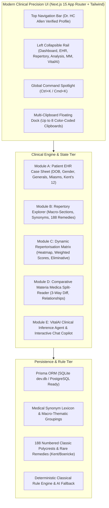

# VitalFokus — Modern Clinical Intelligence & Homeopathic Repertorisation Platform

[](https://nextjs.org/)
[](https://www.typescriptlang.org/)
[](https://tailwindcss.com/)
[](https://www.prisma.io/)
[](LICENSE)

**VitalFokus** is an enterprise-grade, browser-based clinical intelligence, repertorisation, and electronic health record (EHR) platform inspired by industry gold-standards **RadarOpus** and **Similima**. Built with a **Modern Clinical Precision** glassmorphic interface and an integrated **VitalAI Clinical Inference Agent & Chat Copilot**, VitalFokus equips practitioners, researchers, and students with millisecond repertorial analysis grounded in authentic classical homeopathic principles (Kent, Boericke, Hahnemann).

---

## 🌟 Architecture & Capabilities



---

## 📋 Core Modules

### 1. Modern Clinical Precision Workspace
- **Clinical Glassmorphic Design:** Deep slate (`#0B1120`) dark mode and alabaster (`#F8FAFC`) light mode with calming teal (`#0D9488`) and indigo (`#4F46E5`) clinical accents.
- **Top Command Bar (`Ctrl + K` / `Cmd + K`):** Global spotlight search to jump instantly to any patient, rubric, or remedy.
- **Floating Multi-Clipboard Dock:** Up to 8 color-coded symptom clipboards (*Mental Generals, Physical Generals, Particulars, Modalities, Eliminative*). Drag-and-drop rubrics, toggle individual clipboards on/off, assign intensity weights (`1x` to `4x`), and flag mandatory **Eliminative Keynotes**.
- **Practitioner Profile Management:** Interactive profile settings supporting customized clinician credentials (defaulted to verified practitioner **"Dr. HC Allen"**).

### 2. Module A: Structured Homeopathic Case-Taking (EHR)
- **Patient Demographics:** Dedicated Date of Birth (`dateOfBirth`), auto-calculated age, and `gender` tracking, with an interactive **"Edit Demographics"** modal.
- **Digital Case Sheet:** Location, Sensation, Modalities (`<` aggravation, `>` amelioration), Concomitants, Onset/Duration, Mind & Disposition, and Physical Generals (Thermal state, Thirst, Appetite, Cravings/Aversions, Sleep, Perspiration).
- **Miasmatic Load Distribution:** Dynamic visual distribution bar tracking Psora, Sycosis, Syphilis, and Tubercular miasms.
- **Follow-Up Timeline:** Tracks sequential consultations with **Kent's 12 Prognostic Observations**, potency prescribed (`30C`, `200C`, `1M`, `10M`, `LM1`), repetition schedules, and symptom evolution scores (`% improvement`).
- **Smart Symptom-to-Rubric Highlighter:** Highlight free-text clinical notes to auto-query the repertory and stage matches into clipboards in 1 click.

### 3. Module B: Repertory Browser, 188 Numbered Remedies & Synonym Engine
- **Hierarchical Chapter Navigation:** 20 Classic Kentian Chapters (Mind, Vertigo, Head, Eyes, Ears, Face, Mouth, Throat, Stomach, Abdomen, Rectum, Urinary, Female, Respiration, Extremities, Sleep, Fever, Perspiration, Skin, Generalities).
- **Functional Macro-Sections:** Thematic grouping for *Felt Pain Qualities*, *Modern Illnesses & Syndromes*, *Obstetrics & Female Cycles*, and *Life Stages*.
- **Modern Medical Lexicon & Synonym Engine:** Dynamic translation between modern medical terms (e.g., "hypertension", "insomnia", "panic attack", "migraine") and classical repertorial rubrics.
- **188 Numbered Remedies Database:** Pre-seeded with 188 classic remedies (`remedyNumber: 1` through `188`) with complete Kent/Boericke Materia Medica profiles, kingdoms, miasms, thermal states, keynotes, and clinical relationships.
- **Smart Rubric Merging & Clinical Additions:** 1-click merging of sub-rubrics and custom practitioner clinical rubrics tagged `[Clinical Addition - User Verified]`.
- **CSV/JSON Bulk Dataset Importer:** Seamlessly upload public-domain Boericke/Kent/Boger datasets with automated schema validation.

### 4. Module C: RadarOpus-Style Dynamic Repertorisation Matrix
- **Interactive Heat-Map Grid:**
  - **Rows:** Selected rubrics grouped by clipboard, intensity weight, and remedy counts.
  - **Columns:** Matching remedies dynamically ranked by **Classical Totality** (Kent), **Sum of Weighted Grades**, or **Keynote Polarity**.
  - **Color-Coded Cells:** Instant visualization of remedy grade (1 to 4) with 1-click **Quick-Peek Drawer** displaying that remedy's exact Materia Medica confirmation for that symptom.
  - **Eliminative Filtering:** Rubrics tagged as Eliminative immediately flag and filter out remedies lacking that keynote.
  - **Filters:** Kingdom (Plant, Mineral, Animal, Nosode), Thermal polarity (Chilly, Hot, Ambithermal), Miasm, and Prominence (Polycrest vs. Small remedies).

### 5. Module D: Comparative Materia Medica Split-Reader
- Side-by-side split view comparing up to 3 remedies simultaneously (e.g., *Aconitum napellus* vs. *Belladonna* vs. *Gelsemium sempervirens*).
- Highlights guiding spheres of action, mental states, physical generals, and modalities.
- Interactive Relationship Tables: **Complementary, Antidotes, Follows Well, Inimical**.

### 6. Module E: "VitalAI" Clinical Inference Agent & Interactive Chat Copilot
- **Structured Case Analysis:** Ingests structured Case-Taking JSON, Miasmatic profile, Thermal state, and top 15 repertorised remedies.
- **Structured 5-Part Clinical Report:**
  1. **Case Synthesis & Totality Summary:** Core state, constitution, and miasmatic dynamic.
  2. **Top 3–5 Remedy Differentiations:** Match scores, keynote alignment, and thermal concordance.
  3. **Differential Diagnosis & Ruling Out:** Explicit clinical reasons why close runner-ups were eliminated.
  4. **Targeted Clarification Questions:** 3–4 precision questions to ask the patient to confirm the similimum.
  5. **Posology & Potency Consideration:** General classical guidelines based on susceptibility and pathology depth.
- **Interactive Clinical Chat Copilot:**
  - Built-in conversational AI assistant in `VitalAIPanel.tsx` providing step-by-step walkthroughs on repertory usage, mathematical probability explanations, remedy differentiations, and Kent's 12 Observations guidance.
  - Deterministic classical rule engine runs 100% locally with zero external API keys required, plus optional Gemini/OpenAI integration via `.env`.

---

## 🛠️ Technology Stack

| Layer | Technologies |
| :--- | :--- |
| **Framework** | Next.js 15+ (App Router, Server Actions, Route Handlers) |
| **Language** | TypeScript 5 (Strict Mode) |
| **Styling & UI** | Tailwind CSS 3.4, Radix UI Primitives, Lucide Icons, Glassmorphic Design System |
| **State Management**| Zustand (Multi-Clipboard Dock with Local Storage persistence) |
| **Database & ORM** | Prisma ORM 6 with SQLite (`file:./dev.db`) / PostgreSQL ready |
| **Search & Lexicon**| Trigram index, medical synonym normalizer, Kentian rubric hierarchy |
| **AI Integration** | Deterministic Classical Homeopathic Expert System + Optional Gemini / OpenAI APIs |

---

## 📁 Repository Directory Structure

```text
vitalfokus/
├── prisma/
│   ├── schema.prisma              # Database schema (Patient, Remedy, Rubric, Grade, etc.)
│   ├── seed.ts                    # Master database seeder
│   ├── remediesData.ts            # 188 classic remedies with complete MM profiles
│   ├── rubricsData.ts             # Classical Kentian rubrics across 20 chapters
│   ├── macroSectionsData.ts       # Functional macro-thematic groupings
│   ├── synonymsData.ts            # Modern medical synonym translation lexicon
│   └── samplePatients.ts          # Sample clinical cases with follow-up histories
├── scripts/
│   ├── verify-all.ts              # End-to-end 9-subsystem verification test suite
│   ├── build_remedies_188.py      # Automated 188 remedies builder
│   └── generate_full_188.py       # Materia Medica generation pipeline
├── src/
│   ├── app/
│   │   ├── api/
│   │   │   ├── patients/          # Patient EHR CRUD and consultation history
│   │   │   ├── remedies/          # Remedy lookups and Materia Medica profiles
│   │   │   ├── rubrics/           # Rubric search, hierarchy, and clinical additions
│   │   │   ├── repertorisation/   # RadarOpus-style matrix calculation engine
│   │   │   ├── vital-ai/          # Structured clinical inference agent
│   │   │   │   └── chat/          # Interactive clinical chat copilot endpoint
│   │   │   └── importer/          # CSV/JSON bulk dataset importer
│   │   ├── globals.css            # Custom CSS and glassmorphic utility classes
│   │   ├── layout.tsx             # Root layout with Inter font and theme wrapper
│   │   └── page.tsx               # Primary single-page multi-module workspace
│   ├── components/
│   │   ├── clipboards/            # Multi-clipboard floating dock (Zustand)
│   │   ├── dashboard/             # Clinical overview and quick metrics
│   │   ├── importer/              # Dataset bulk importer modal
│   │   ├── layout/                # TopNavbar (Dr. HC Allen) and Sidebar
│   │   ├── materia-medica/        # MM Reader and 3-Way Comparative Split Reader
│   │   ├── patients/              # Structured EHR Case Sheet & Demographics Modal
│   │   ├── repertorisation/       # Dynamic repertorisation heat-map matrix
│   │   ├── repertory/             # Chapter tree browser & synonym search
│   │   └── vital-ai/              # VitalAI inference report & interactive Chat Copilot
│   └── lib/
│       ├── prisma.ts              # Global Prisma client singleton
│       └── store/
│           └── useClipboardStore.ts # Zustand multi-clipboard state manager
├── .env.example                   # Example environment configuration
├── .gitignore                     # Git ignore rules (excluding binary SQLite DB)
├── package.json                   # Dependencies and npm scripts
├── tsconfig.json                  # TypeScript compiler options
└── README.md                      # Comprehensive platform documentation
```

---

## 🚀 Quickstart & Installation

### 1. Clone & Install Dependencies
```bash
# Clone the repository
git clone https://github.com/ankur608/VitalFokus.git
cd VitalFokus/vitalfokus

# Install dependencies
npm install
```

### 2. Configure Environment
```bash
cp .env.example .env
```
*(The default `DATABASE_URL="file:./dev.db"` runs out-of-the-box with zero configuration required).*

### 3. Initialize & Seed Database
```bash
# Push Prisma schema to SQLite
npx prisma db push

# Seed 188 numbered remedies, Kentian rubrics, synonyms, and clinical cases
npm run seed
```

### 4. Run End-to-End Verification Test Suite
```bash
npx tsx scripts/verify-all.ts
```
Expected output:
```text
=== VitalFokus End-to-End System Verification ===
[1/9] Verifying Database Connection & Remedies... PASS (188 remedies loaded, numbered 1..188)
[2/9] Verifying Macro-Sections & Synonyms... PASS (5 macro-sections, modern medical synonyms verified)
[3/9] Verifying Patient EHR Demographics... PASS (DOB, Age, and Gender fields confirmed)
[4/9] Verifying Repertory Explorer & Rubrics... PASS
[5/9] Verifying Multi-Clipboard Store Math... PASS
[6/9] Verifying Repertorisation Matrix Engine... PASS
[7/9] Verifying Comparative Materia Medica... PASS
[8/9] Verifying VitalAI Clinical Inference Engine... PASS
[9/9] Verifying VitalAI Interactive Chat Copilot... PASS
ALL 9 VITALFOKUS SUBSYSTEMS VERIFIED 100% OPERATIONAL!
```

### 5. Launch Development Server
```bash
npm run dev
```
Open **[http://localhost:3000](http://localhost:3000)** in your browser.

---

## 🔍 Keyboard Shortcuts & Navigation
- `Ctrl + K` or `Cmd + K`: Open Global Spotlight Command Search.
- Click any rubric row to preview remedy grades and add directly to any of the 8 clipboards.
- Click any cell in the **Repertorisation Grid** to open the quick-peek drawer confirming the remedy's symptom in the Materia Medica.
- Click **"VitalAI Chat Copilot"** tab in the AI section to ask questions or receive guided walkthroughs on repertory analysis.

---

## 📜 Medical Informatics Disclaimer
VitalFokus and VitalAI are designed as clinical decision-support and educational tools for qualified homeopathic practitioners and students. All therapeutic suggestions, repertorial scores, and posology guidelines must be interpreted in light of clinical judgment and individual patient susceptibility.

---

## 📄 License
This project is dedicated to the public domain under the [Creative Commons Zero v1.0 Universal License (CC0 1.0)](LICENSE) by **ankur608**.
Kent, Boericke, and classical repertorial texts utilized are in the public domain.
